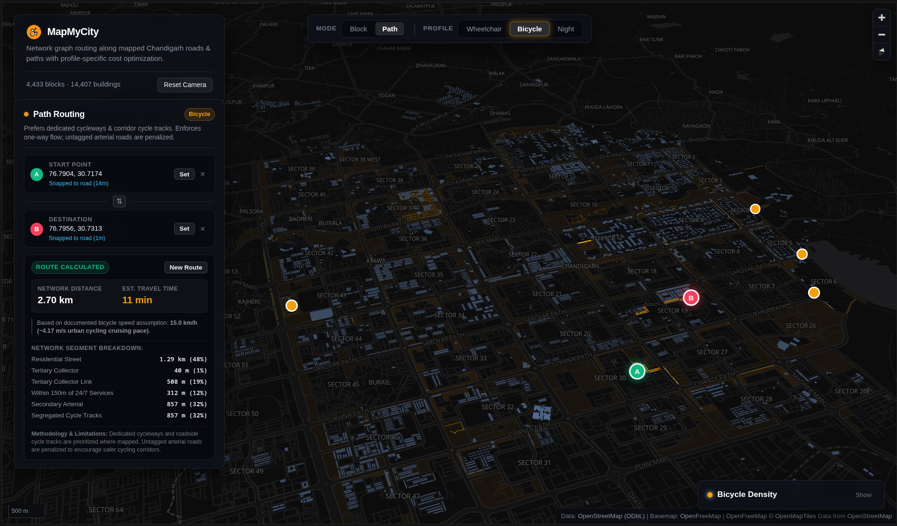
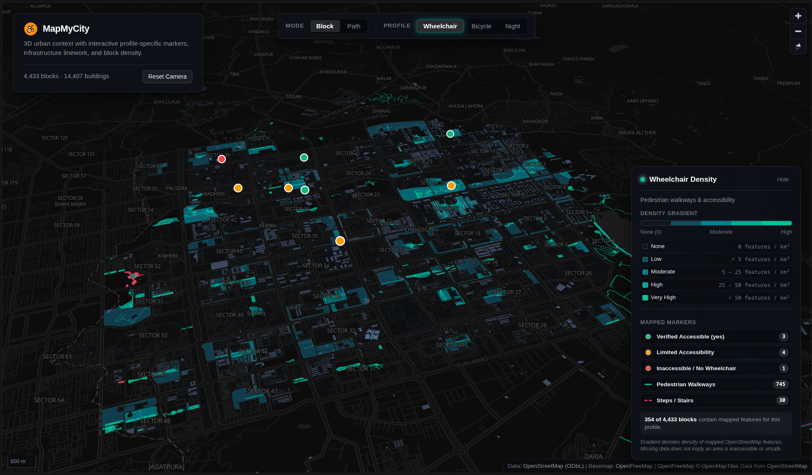
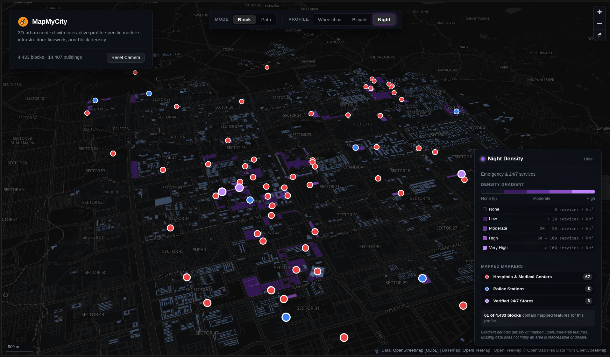

<div align="center">

  

  # MapMyCity

  **Accessible, context-aware 3D urban mapping and client-side network routing for Chandigarh.**

  [](https://react.dev/)
  [](https://www.typescriptlang.org/)
  [](https://vitejs.dev/)
  [](https://maplibre.org/)
  [-7EBC6F?logo=openstreetmap&logoColor=white)](https://www.openstreetmap.org/copyright)
  [](https://openfreemap.org/)

  [Overview](#overview) •
  [Key Features](#key-features) •
  [Visual Showcase](#interface--visual-showcase) •
  [Profiles & Personas](#profiles--personas) •
  [Architecture](#architecture--technical-stack) •
  [Routing Algorithm](#client-side-routing-engine) •
  [Getting Started](#getting-started) •
  [Data Provenance](#data-provenance--audit)

  <br />

  <p align="center">
    
  </p>

</div>

---

## Overview

**MapMyCity** is an open-source, client-side geospatial application designed around the iconic modernist sector grid of **Chandigarh, India** (designed by Le Corbusier and Pierre Jeanneret).

Unlike conventional web maps that display static pins or unweighted driving directions, MapMyCity provides **profile-specific urban density intelligence** and **pedestrian/cycling network routing** computed entirely in the browser using verified OpenStreetMap data.

### Core Principles

- **Data Honesty**: No fabricated accessibility indexes or fake "safety scores". The application visualizes only explicitly mapped infrastructure tags (`wheelchair`, `lit`, `cycleway`, `steps`, `opening_hours: 24/7`).
- **High-Performance Client-Side Graph**: Custom topological network graph (45,975 nodes, 105,876 directed edges) with spatial grid indexing for sub-millisecond edge snapping and shortest-path computation.
- **3D Context & Block Choropleths**: 4,433 derived urban blocks colored by feature density gradient, combined with 14,407 3D building extrusions.
- **Restrained Cartography**: Minimalist dark visual hierarchy engineered for data readability, high contrast, and smooth interactive exploration.

---

## Key Features

### 1. Block Mode: 3D City & Feature Density
- **Urban Block Density Gradient**: Visualizes feature density per square kilometer across 4,433 urban blocks using calibrated 5-tier color ramps for each profile.
- **3D Building Extrusions**: Thousands of building footprints rendered with accurate height-based extrusions and ambient lighting.
- **Interactive Feature Inspect**: Click on any block, building, cycle track, walkway, hospital, or police station to inspect verified OpenStreetMap tags and provenance.

### 2. Path Mode: Network Graph Routing
- **Point-and-Click Routing**: Set **Start (A)** and **Destination (B)** anywhere in Chandigarh by clicking directly on the map.
- **Sub-Millisecond Spatial Snapping**: Automatically snaps clicks to the nearest road network centerline within a 250-meter tolerance threshold.
- **Route Direction & Reversal**: Instant one-click endpoint swap (⇄) with automatic one-way street re-routing.
- **Segment Breakdown & Speed Assumptions**: Detailed breakdown of traveled road classifications (arterials, pedestrian paths, segregated cycle tracks, lit corridors) and realistic travel duration estimates.

---

## Profiles & Personas

MapMyCity tailors cartography and routing dynamically across three distinct profiles:

| Profile | Accent Color | Primary Map Overlays | Routing Multiplier Logic | Calibrated Speed |
| :--- | :--- | :--- | :--- | :--- |
| **Wheelchair** | `#00c49f` (Emerald) | Mapped walkways (745), stairs (30), verified accessible POIs (8) | Avoids stairs ($500\times$ penalty); prefers footways ($0.6\times$); bonus for `wheelchair=yes` ($0.5\times$); penalizes high-speed motorways ($2.5\times$) | 3.6 km/h (~1.0 m/s) |
| **Bicycle** | `#f59e0b` (Amber) | Dedicated cycleways (12), corridor tracks (784), bike parking (4) | Strictly enforces one-way street/roundabout flow ($\infty$ for reverse); prefers cycleways ($0.4\times$) and tracks ($0.5\times$); avoids stairs | 15.0 km/h (~4.17 m/s) |
| **Night Transit** | `#a855f7` (Violet) | Lit streets (126), hospitals (67), police stations (8), 24/7 stores (3) | Prefers verified illuminated streets ($0.8\times$) and ways within 150m of emergency/24h services ($0.85\times$) | 4.5 km/h (~1.25 m/s) |

---

## Interface & Visual Showcase

### 1. 3D Urban Blocks & Density Gradients (Block Mode)
> Dynamic choropleth tiles representing feature density across 4,433 urban blocks, combined with 14,407 3D building extrusions and clickable OpenStreetMap inspection cards.

<p align="center">
  
</p>

### 2. Client-Side Topological Routing (Path Mode)
> Point-and-click route planning with sub-millisecond road snapping, obstacle avoidance (stairs penalty), legal one-way enforcement, and complete highway segment breakdown.

<p align="center">
  
</p>

### 3. Night Transit & Emergency Corridor Coverage
> Prioritizing 126 mapped illuminated street segments and corridors within 150m of 24/7 hospitals, police stations, and verified round-the-clock convenience stores.

<p align="center">
  
</p>

---

## Client-Side Routing Engine

The routing pipeline runs entirely in WebAssembly/JavaScript without calling external routing APIs:

```
[ User Click A ]                    [ User Click B ]
       │                                   │
       ▼                                   ▼
 [ Spatial Snap ]                    [ Spatial Snap ]
  (Grid <= 250m)                      (Grid <= 250m)
       │                                   │
       ▼                                   ▼
[ Virtual __START__ ]               [ Virtual __DEST__ ]
       │                                   │
       └────────►  Dijkstra Search  ◄──────┘
               (Profile-Weighted Costs)
                         │
                         ▼
             [ Backtrack & Reconstruct ]
                         │
                         ▼
        [ Exact GeoJSON Route + Stats ]
```

### Topological Graph Structure ([`networkGraph.ts`](src/services/routing/networkGraph.ts))
- **Node Coalescing**: Consecutive coordinates within ~1.1 cm (`1e-7 deg`) are merged to establish topological connectivity at true intersections.
- **Grade Separation**: Flyovers, bridges (`bridge=yes`), and tunnels that do not share node vertices in OSM are preserved as grade-separated without false intersection turns.
- **2D Spatial Grid**: Pre-indexes segments into ~500m cells (`0.005 deg`) for fast nearest-edge projections.

### Dynamic Edge Weighting ([`dijkstraRouter.ts`](src/services/routing/dijkstraRouter.ts))
Traversal cost is calculated per edge segment:
$$\text{Cost} = \text{Distance (meters)} \times \text{Profile Multiplier}$$

A binary `MinHeap` priority queue traverses the graph from `__START__` to `__DEST__` and reconstructs the clean coordinate sequence, deduplicating adjacent vertices.

---

## Architecture & Technical Stack

```
mapmycity/
├── public/
│   ├── data/                 # Cleaned GeoJSON layers (blocks, roads, POIs)
│   ├── snapshots/            # Production preview captures
│   ├── favicon.svg           # Vector application logo & favicons
│   └── site.webmanifest      # Progressive Web App manifest
├── src/
│   ├── components/
│   │   ├── Map/
│   │   │   └── MapContainer.tsx   # MapLibre GL instance, layers & camera
│   │   └── UI/
│   │       ├── Header.tsx         # Brand logo, title & overview metadata
│   │       ├── ControlBar.tsx     # Mode (Block/Path) & Profile switcher
│   │       ├── Legend.tsx         # Compact density ramp & mapped markers
│   │       ├── RoutingPanel.tsx   # Origin/Destination pickers & metrics
│   │       └── ErrorNotice.tsx    # Non-blocking error alerts
│   ├── config/
│   │   └── mapConfig.ts      # Colors, layer IDs, thresholds & styles
│   ├── services/
│   │   └── routing/
│   │       ├── networkGraph.ts    # Graph topology, edges & spatial grid
│   │       ├── dijkstraRouter.ts  # Dijkstra pathfinder & segment metrics
│   │       └── presets.ts         # Verified benchmark origin/destinations
│   ├── types/
│   │   └── map.ts            # TypeScript interfaces & GeoJSON typings
│   ├── App.tsx               # Root component wrapper
│   ├── App.css               # Dark theme layout & component styles
│   └── main.tsx              # React DOM entry point
├── scripts/
│   ├── generate-blocks.mjs               # Polygon cell generation from linework
│   ├── generate-wheelchair-points.mjs   # Wheelchair accessibility extractor
│   └── verify-phase5-data-and-routes.mjs # Automated audit & routing test suite
├── docs/
│   └── data-audit.md         # Full factual reconciliation audit log
└── package.json
```

### Core Technologies
- **Framework**: [React 19](https://react.dev/) + [TypeScript](https://www.typescriptlang.org/)
- **Build Tool**: [Vite 8](https://vitejs.dev/) with Rolldown / ESBuild bundler
- **Map Renderer**: [MapLibre GL JS 6.15.0](https://maplibre.org/)
- **Vector Basemap**: [OpenFreeMap](https://openfreemap.org/) (Liberty Dark schema with localized labels)
- **Code Quality**: ESLint 10 + TypeScript-ESLint + React Hooks plugin

---

## Getting Started

### Prerequisites
- [Node.js](https://nodejs.org/) v18.0.0 or higher
- `npm` or `pnpm`

### Installation

1. Clone the repository:
   ```bash
   git clone https://github.com/paanipoorie/mapmycity.git
   cd mapmycity
   ```

2. Install dependencies:
   ```bash
   npm install
   ```

3. Start the local development server:
   ```bash
   npm run dev
   ```
   Open your browser at `http://localhost:5173`.

### Production Build

Compile TypeScript and build the optimized production bundle:
```bash
npm run build
npm run preview
```

### Verification & Testing Suite

Run the automated data audit and network routing validation script:
```bash
npm run verify-phase5
```
This test suite verifies:
- All 9 dataset counts and reconciliation against OSM ground truth.
- Graph connectivity (45,975 nodes, 52,938 undirected segments).
- Snapping tolerances (> 250m rejection).
- One-way bicycle and roundabout detour enforcement.
- Symmetrical route reversal and profile path differentiation.

---

## Data Provenance & Audit

All urban linework, administrative boundaries, and infrastructure facilities are sourced directly from OpenStreetMap:

| Dataset | Feature Count | OpenStreetMap Tag Criteria |
| :--- | :--- | :--- |
| `chandigarh_osm.geojson` | 26,270 | Mapped buildings (`building=*`) and highways (`highway=*`) |
| `chandigarh_blocks.geojson` | 4,433 | Geometric polygons derived from street network enclosure |
| `chandigarh_pedestrian.geojson` | 775 | Footways, pedestrian paths (745) and steps/stairs (30) |
| `chandigarh_cycleways.geojson` | 12 | Dedicated segregated cycleways (`highway=cycleway`) |
| `chandigarh_bicyclepark.geojson`| 4 | Verified bicycle parking stands (`amenity=bicycle_parking`) |
| `chandigarh_hospitals.geojson` | 67 | Hospitals & medical emergency facilities (`amenity=hospital`) |
| `chandigarh_police.geojson` | 8 | Law enforcement stations (`amenity=police`) |
| `chandigarh_24shops.geojson` | 3 | Explicitly verified 24/7 stores (`opening_hours: 24/7`) |
| `chandigarh_wheelchair_points.geojson`| 8 | Points with explicit accessibility tags (`wheelchair=yes\|limited\|no`) |

*For complete auditing methodology, see [`docs/data-audit.md`](docs/data-audit.md).*

---

## License & Attribution

- **Code**: MIT License.
- **Map Data**: © [OpenStreetMap](https://www.openstreetmap.org/copyright) contributors, licensed under the [Open Database License (ODbL)](https://opendatacommons.org/licenses/odbl/).
- **Basemap Tiles**: Hosted by [OpenFreeMap](https://openfreemap.org/).
- **Urban Heritage**: Based on the master plan of Chandigarh by Le Corbusier, Pierre Jeanneret, Jane Drew, and Maxwell Fry.
